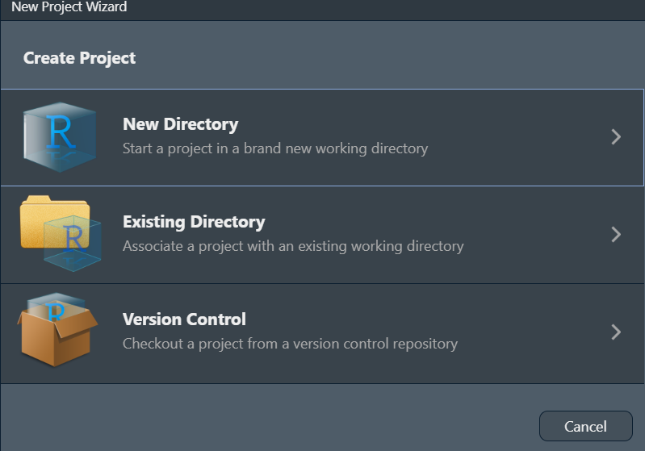
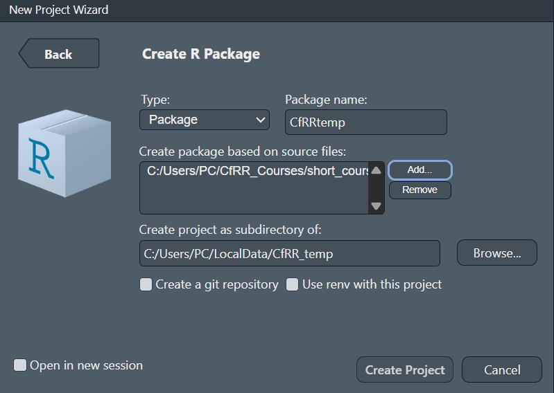
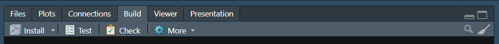

# Building your first R package

```{card}

<div class="alert alert-block" style="background-color: #ffffff; border: 1px solid #ccc; padding: 1em; border-radius: 8px;">

**Author:** Juan Benavides-Tocarruncho (GitHub: [jbenavidest](https://github.com/jbenavidest)).  

**License:** Creative Commons Attribution-ShareAlike 4.0 International license ([CC BY-SA 4.0](https://creativecommons.org/licenses/by-sa/4.0/)).

</div>

```


## Intended Learning Outcome 

By the end, you should be able to:

- Understand the general steps for creating an R package.
- Document and export one function, then install the package locally.
- Use the installed package, call the function and find its help in a fresh R session

## Prerequisites and setup

This course is done in R and we encourage to use RStudio as main coding environment. Before making your first R package, you should be familiar writing [R functions](r_functions.ipynb) and using [R projects and environments](r_environments.ipynb). Remember to run the R blocks in an R console, not a shell terminal.

Before the timed lesson, install the development tools:

```r
install.packages(c("usethis", "devtools", "roxygen2"))
```

Some tool installations and source builds need system tools: Rtools on Windows, Xcode command line tools on macOS, or R development tools on Linux. Follow the [R Packages system-setup guide](https://r-pkgs.org/setup.html) for your platform. Complete setup before starting the timed lesson.

## 1. Create a package

**What is an R Package?** It is a collection of functions, documentation and example data that can be reused and shared easily within users. Usually, new methods developed as part of research can be shared in the form of a package to enhance reproducibility and allow other researchers apply the same methods, i.e. the same R functions. 

In this example, we will develop a simple package `cfrrtemps` that will contain a function to convert temperatures. The general steps for creating a packages can be as follow:

1. Create function
2. Document functions
3. Create a package project 
4. Add Functions to the package 

You can start creating your package using the Project wizard from RStudio. When selecting a new R project, you can select the first option.



Then instead of selection select "R Package" 


Here you can select the main settings of your package:

- name of your package: it does not allow undersoce 
- the source files where the functions will be in you can add more afterwards as well
- the main folder where all the packages should be: you can even create a git repository for it to keep track of any changes.




You can also create the package using the promtline of R in a new unused folder. Copy this starter metadata; the example author details can be personalised later if you share the package:
```r
usethis::create_package(
  "~/CfRRtemp",
  fields = list(
    Title = "Simple Temperature Conversions",
    Description = "A small teaching package for converting temperatures.",
    "Authors@R" = 'person("Learner", "Example", email = "learner@example.org", role = c("aut", "cre"))'
  ),
  open = TRUE
)
```

In RStudio, you can continue in the newly opened package project. You can open the project normally with an R session. The wizard should have created the following files and folder:


| Location | Purpose |
| --- | --- |
| `DESCRIPTION` | Package name, version, authors, and licence. |
| `R/` | Function source files. |
| `NAMESPACE` | Public functions; generated from roxygen comments. |
| `man/` | Help files generated from roxygen comments. |

## 2. Add a documented function

Save the following as `R/celsius_to_fahrenheit.R`:

```r
#' Convert Celsius temperatures to Fahrenheit
#'
#' @param celsius A numeric vector of temperatures in degrees Celsius.
#' @returns A numeric vector of temperatures in degrees Fahrenheit.
#' @export
#' @examples
#' celsius_to_fahrenheit(c(0, 100))
celsius_to_fahrenheit <- function(celsius) {
  celsius * 9 / 5 + 32
}
```

Generate the help and namespace from the package project:

```r
devtools::document()
```

The `#'` comments become help in `man/`; `@export` makes this function available through the package's public namespace. Look at the generated files. Edit the source comments and rerun `document()` when they change, rather than editing generated files by hand.

## 3. Install and use the package

To test the package functions you can load it using going to the "Build" tab and click "Install". 





From the package project:

```r
devtools::install()
```

Start a fresh R session (in RStudio, use **Session → Restart R**), then run:

```r
CfRRtemp::celsius_to_fahrenheit(c(0, 100))
help("celsius_to_fahrenheit", package = "CfRRtemp")
```

Expect `32 212` and the installed help page. The `CfRRtemp::` prefix selects the installed package's exported function; you do not need to source the function file in this fresh session.

## 4. Quick exercise and recap

Call the installed function with `c(-40, 100)`. Predict the result before running it.

**Expected result:** `-40 212`. **Hint:** Use `CfRRtemp::celsius_to_fahrenheit(c(-40, 100))`.

Explain what happened at each step: create source files, document the function, install the package, then use it in a fresh session. Which files do you edit, and which does roxygen generate?

## Optional next steps

- [R Packages: The Whole Game](https://r-pkgs.org/whole-game.html): a worked package-development walkthrough.
- [roxygen2 introduction](https://roxygen2.r-lib.org/articles/roxygen2.html): generating help and exports from source comments.
- [R unit testing](r_unit_testing.ipynb): add automated tests after completing this lesson.
- [devtools package checks](https://devtools.r-lib.org/reference/check.html): learn broader checks before sharing a package.
- [Writing R Extensions](https://cran.r-project.org/doc/manuals/r-release/R-exts.html): reference material for dependencies, source packages, and distribution.